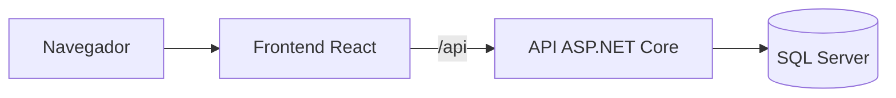

# Task Flow

## Introdução

Task Flow é uma aplicação web para organizar tarefas, pessoas responsáveis e prazos. Você pode criar subtarefas, acompanhar o progresso e encontrar o trabalho da equipe por filtros. O projeto foi pensado para uso local, sem autenticação; o banco começa vazio para você cadastrar as primeiras pessoas e tarefas.

## Tecnologias e arquitetura

- **Frontend:** React, TypeScript, React Router e Vite.
- **Backend:** ASP.NET Core 10, EF Core 10 e SQL Server.
- **Docker Compose:** inicia o banco, aplica as migrações e publica a aplicação.



O frontend organiza as páginas em `Frontend/src/app` e as funcionalidades em `Frontend/src/features`. O backend separa entidades em `Domain`, regras em `Application`, acesso a dados em `Infrastructure` e endpoints em `API`.

## Como executar

### Com Docker

**Pré-requisitos:** Docker com Compose e contêineres Linux em um computador x86-64 (Intel ou AMD). O SQL Server precisa de pelo menos 2 GB de RAM disponíveis; reserve mais memória para a API e a construção das imagens.

1. Na raiz do repositório, copie `.env.example` para `.env` (`Copy-Item .env.example .env` no PowerShell ou `cp .env.example .env` no Bash).
2. Edite `.env` e defina `MSSQL_SA_PASSWORD` com pelo menos oito caracteres, incluindo maiúscula, minúscula, número e símbolo. Evite ponto e vírgula, aspas e cifrão. O arquivo `.env` é ignorado pelo Git. Se a porta 5173 estiver ocupada, altere `WEB_PORT`.
3. Inicie os serviços com `docker compose up --build -d --wait` e abra [http://127.0.0.1:5173](http://127.0.0.1:5173), ou a porta configurada em `WEB_PORT`.

Se a inicialização falhar, consulte `docker compose ps` e `docker compose logs sqlserver migrate api frontend`. Para parar os serviços sem apagar os dados, use `docker compose down`. Os dados ficam no volume `sqlserver_data`; `docker compose down --volumes` remove esse volume. Ao reutilizar o volume, mantenha a mesma senha, pois editar `.env` não altera a senha já gravada pelo SQL Server. Veja [como fazer backup do banco](docs/backup.md).

### Sem Docker

Instale .NET SDK 10, Node.js 24 e SQL Server. A configuração de desenvolvimento em `Backend/TaskFlow.API/appsettings.Development.json` usa autenticação integrada do Windows. Em outro ambiente, defina `ConnectionStrings__DefaultConnection` com a sua conexão. Faça backup antes de aplicar migrações a um banco com dados.

Na raiz do repositório, inicie a API:

```powershell
dotnet tool restore
$env:ASPNETCORE_ENVIRONMENT = "Development"
$env:ASPNETCORE_URLS = "http://127.0.0.1:5188"
dotnet ef database update --project Backend/TaskFlow.Infrastructure --startup-project Backend/TaskFlow.API
dotnet run --project Backend/TaskFlow.API --no-launch-profile
```

No Bash, use `export ASPNETCORE_ENVIRONMENT=Development` e `export ASPNETCORE_URLS=http://127.0.0.1:5188` no lugar das duas atribuições PowerShell. Em outro terminal, na raiz do repositório, inicie o frontend:

```powershell
cd Frontend
npm ci
npm run dev
```

Abra [http://127.0.0.1:5173](http://127.0.0.1:5173). O Vite encaminha `/api` para a API na porta `5188`.

### Testes

Na raiz do repositório:

```powershell
dotnet test Backend/TaskFlow.sln
cd Frontend
npm ci
npm test
npm run lint
npm run build
```

Os testes de integração com SQL Server são separados. Defina `TASKFLOW_TEST_SQL_CONNECTION` para **um servidor de testes** com permissão para criar bancos temporários e execute `dotnet test Backend/TaskFlow.IntegrationTests/TaskFlow.IntegrationTests.csproj` na raiz. A CI executa esses testes em um SQL Server isolado e verifica a aplicação via Compose.

## O que experimentar

1. Cadastre uma pessoa e crie uma tarefa com responsável, prioridade e prazo.
2. Busque, filtre e ordene tarefas; os filtros ficam na URL para compartilhar a consulta.
3. Adicione subtarefas e acompanhe o progresso e os indicadores de prazo no Resumo.

O responsável ajuda a organizar as tarefas, mas não restringe quem pode vê-las ou editá-las.
